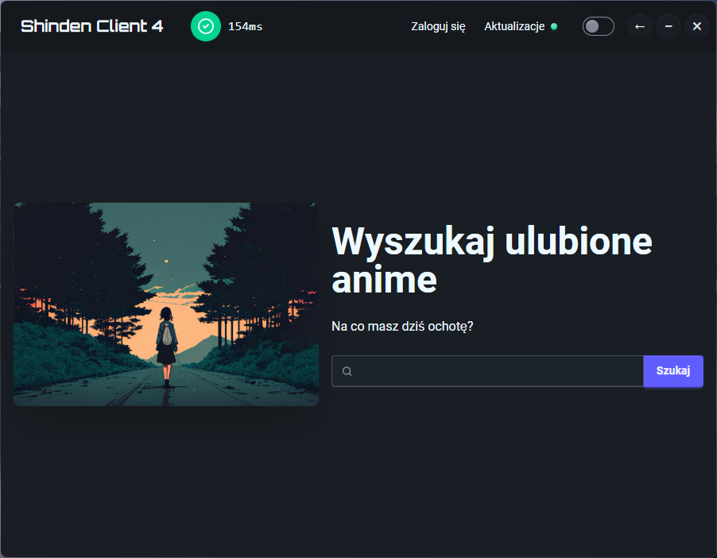
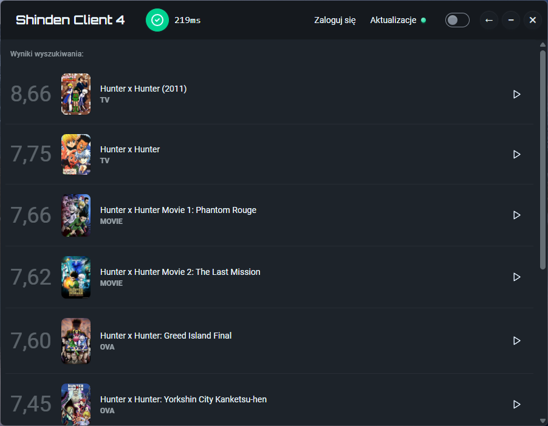
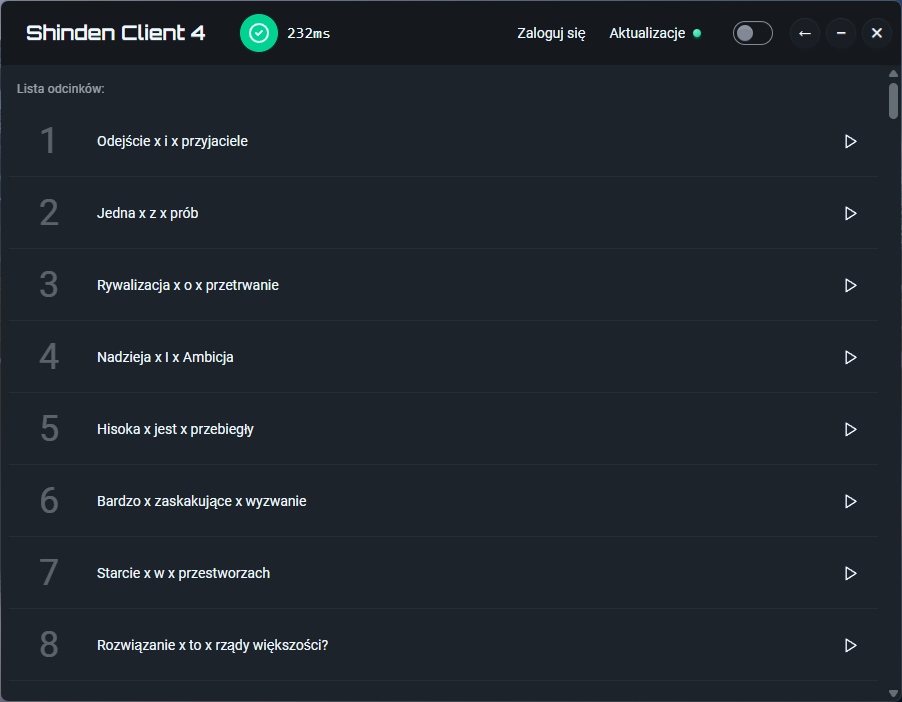
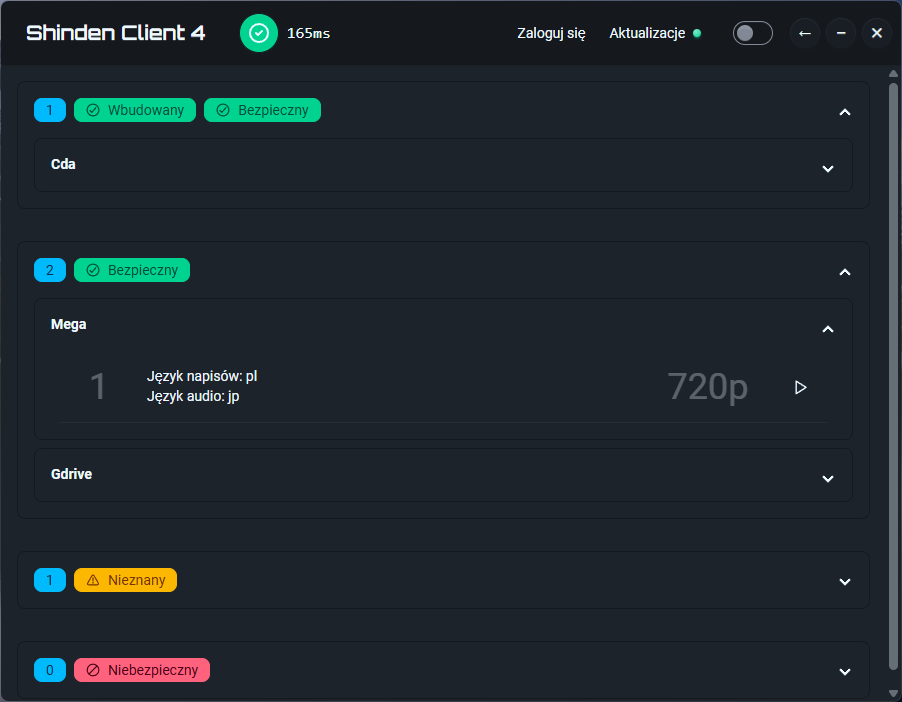
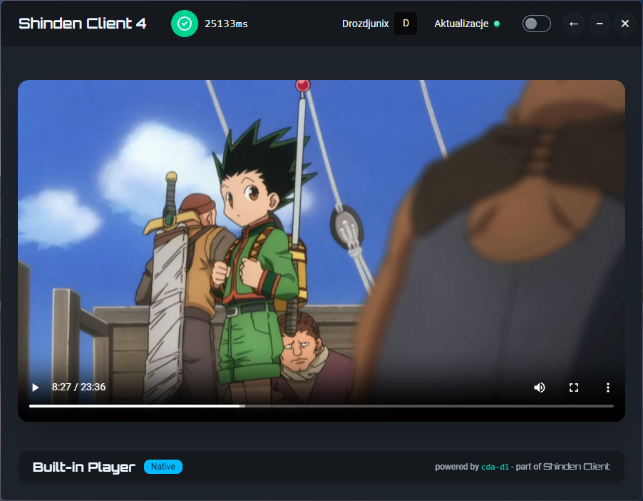

# Shinden Client 4

Aplikacja desktopowa dla użytkowników serwisu Shinden.pl. Zbudowana przy użyciu frameworka Tauri (Rust + SvelteKit).


## Opis projektu

Shinden Client to natywne rozwiązanie umożliwiające przeglądanie zasobów serwisu Shinden.pl. Głównym celem projektu jest dostarczenie wydajnego interfejsu, pozbawionego reklam i elementów śledzących, typowych dla standardowych przeglądarek internetowych.

## Funkcjonalności

- Wysoka wydajność i szybki czas uruchamiania.
- Interfejs oczyszczony z reklam oraz okien typu popup.
- Obsługa motywów jasnego i ciemnego.
- Zintegrowana konsola logów ułatwiająca diagnostykę.
- Natywny odtwarzacz wspierający treści z cda.pl bez reklam.

## Lokalna biblioteka i profile

Aplikacja przechowuje bibliotekę w jednym pliku SQLite, bez instalowania serwera.
Ścieżka pliku jest widoczna w **Ustawieniach**; domyślnie jest to
`%LOCALAPPDATA%\shinden-client\library.sqlite3` na Windows.
Na pozostałych systemach używany jest lokalny katalog danych użytkownika.
Zmienna `SHINDEN_LIBRARY_PATH` pozwala wskazać inny plik, np. do testów.

Każde uruchomienie zaczyna się w profilu **Guest**. Jawne logowanie do Shinden wybiera profil nazwany
nickiem konta. Profile mają osobne listy, statusy, oceny, postęp, opisy, kategorie,
adresy grafik, zapisane grafiki oraz pobrane listy i linki odcinków. Statusy
Oglądam, Obejrzane, Planuję, Wstrzymane, Porzucone i Pomijam są logicznymi
folderami w bazie. Pozostałe odcinki wyliczane są z liczby obejrzanych i znanej
liczby wszystkich odcinków; nieznana liczba nie jest zastępowana zerem.

Zapisane profile można przełączać lokalnie w ustawieniach, również bez sesji
serwisu. Wylogowanie przełącza na Guest. **Statusy, oceny i obejrzane odcinki
nie są wysyłane do Shinden**, również po zalogowaniu.

Połączenia z Shinden są domyślnie wyłączone. Włączenie opcji w ustawieniach
pozwala pobierać nowe dane. Publiczne dane są pobierane osobnym klientem,
bez cookies konta. Sesja logowania jest przechowywana tylko w pamięci i używana
do jawnie wybranego dostępu do odtwarzaczy wymagających konta. Okna Shinden
działają w trybie prywatnym. Wyłączenie połączeń blokuje kolejne żądania,
także w operacjach przygotowujących odtwarzacz; już wysłane żądanie może się
zakończyć. Odpowiedź o blokadzie dostępu lub HTTP 429 wyłącza dalsze połączenia.

Nie ma automatycznych skanów ani automatycznego wznowienia logowania.
Szczegóły i listy odcinków są zapisywane podczas otwierania anime albo przez
ręczny przycisk pobierania w bibliotece. Dostępność odtwarzaczy można odświeżyć
ręcznie w widoku Oglądam. Linki osadzania odtwarzaczy są pobierane ponownie
przy odtwarzaniu online, ponieważ mogą wygasać.

### Import publicznych list

W **Ustawieniach** włącz połączenia i **Import publicznych list**. Wyszukaj nick
albo wklej pełny adres, np. `https://shinden.pl/user/458357-nefilimpl`, następnie
wybierz **Importuj do [profil]**. Import nie loguje na konto źródłowe i nie
przełącza profilu docelowego. Dodaje dostępne publicznie pozycje wraz z opisami,
okładkami i licznikami postępu. Ponowny import zachowuje istniejące lokalne
zmiany. Prywatne lub zablokowane listy mogą być niedostępne.

Cała lista jest sprawdzana przed zapisem w transakcji. Błąd, niepełna odpowiedź
lub anulowanie przed zatwierdzeniem nie zmienia biblioteki. Kategorie i linki
poszczególnych odcinków uzupełnia się przy otwarciu anime albo ręcznym pobraniu
szczegółów. Stary wspólny cache JSON nie jest automatycznie przypisywany
żadnemu profilowi, ponieważ nie zawiera informacji o właścicielu.

Kopię `library.sqlite3` wykonuj po zamknięciu aplikacji. Baza nie zawiera plików
filmów. Zapisany odtwarzacz może nadal wymagać połączenia z jego dostawcą,
a jego adres może wygasnąć. Lokalna baza ogranicza ruch do Shinden, ale
po włączeniu sieci serwis nadal widzi IP, a żądania z aktywną sesją konta
pozwalają rozpoznać konto.

## Weryfikacja połączenia z Shinden

Jeżeli Cloudflare zażąda weryfikacji, aplikacja wyświetli komunikat z przyciskiem
**Zweryfikuj połączenie**. W otwartym oknie poczekaj na załadowanie strony Shinden
i wykonaj ewentualną weryfikację. Wróć do aplikacji i wybierz
**Weryfikacja zakończona — sprawdź połączenie**.

Aplikacja przejmie potwierdzenie Cloudflare i sprawdzi połączenie przed odświeżeniem
widoku. Sesja logowania aplikacji zostaje zachowana. Gdy potwierdzenie wygaśnie,
można powtórzyć weryfikację. Zwykły błąd 403 bez żądania weryfikacji nie uruchamia
tego procesu. Przejście weryfikacji w osobnej przeglądarce systemowej nie przenosi
jej sesji do aplikacji.

## Logowanie

Na ekranie konta wybierz **Zaloguj w oknie Shinden**. Zaloguj się loginem lub e-mailem
i hasłem na oficjalnej stronie w otwartym oknie, następnie wróć do aplikacji i wybierz
**Zalogowano — sprawdź konto**. Aplikacja sprawdzi sesję przed wyświetleniem nazwy konta.

## Kompatybilność

| System operacyjny | Status wsparcia |
|-------------------|-----------------|
| Windows           | Pełne           |
| macOS             | Pełne           |
| GNU/Linux         | Częściowe       |

### Wsparcie na systemach GNU/Linux

W środowiskach wykorzystujących protokół Wayland mogą wystąpić problemy z renderowaniem interfejsu. W takim przypadku zaleca się skorzystanie z X11 lub uruchomienie aplikacji z wyłączonym rendererem DMABUF:

```bash
WEBKIT_DISABLE_DMABUF_RENDERER=1 ./shinden-client.AppImage
```

Problem wynika bezpośrednio z działania WebKitGTK wewnątrz frameworka Tauri. Dokumentacja błędu dostępna jest w [repozytorium Tauri](https://github.com/tauri-apps/tauri/issues/10702).

## Zrzuty ekranu







## Licencja i wyłączenie odpowiedzialności

MIT © 2025 Błażej Drozd, NefilimPL

Projekt Shinden Client nie jest powiązany z serwisem Shinden.pl. Aplikacja nie hostuje ani nie redystrybuuje treści objętych prawem autorskim. Służy wyłącznie jako alternatywny interfejs użytkownika.

## Wsparcie rozwoju

- Prześlij zgłoszenie błędu (Issue).
- Zaproponuj zmiany poprzez Pull Request.
- Pomóż w testowaniu nowych wersji aplikacji.
